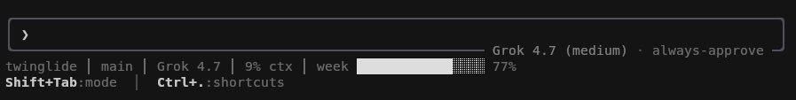

# grok-statusline

Adds a weekly or monthly allowance bar to Grok Build's status line, next to the folder, branch, model, and context %.



```
my-app │ main │ Grok 4.7 │ 12% ctx │ week ████████████░░░░ 76%
```

## Why

The bar shows the same `creditUsagePercent` as the **Weekly limit** bar in `/usage`. Neither the built-in status row (cwd, model, context, cost, turn timer, session name) nor the session JSON piped to status scripts includes the weekly limit, so this script fetches it.

## Install

Requires Grok Build 1.0.7+ (for timer refresh) and Python 3 (no dependencies).

```sh
curl -o ~/.grok/statusline.sh https://raw.githubusercontent.com/jmdevilleros/grok-statusline/main/statusline.sh
chmod +x ~/.grok/statusline.sh
```

Add to `~/.grok/config.toml`:

```toml
[ui.status_line]
type = "command"
command = "~/.grok/statusline.sh"
refresh_interval = 300
```

`refresh_interval` is in seconds. Restart Grok once, since it reads this table at startup. After that, script edits apply on the next refresh.

## Behavior

- The label is `week` or `month`, depending on your plan.
- The bar is white under 80%, yellow from 80%, and red from 95%.
- The value is cached in `~/.grok/statusline-weekly.json`. Starting Grok fetches once, even when that cache is still fresh, so a reset that happened while Grok was closed shows up on the first paint. After that, busy turns reuse the cache. The script fetches again when the timer fires or the cache is older than 5 minutes.
- If a request fails, it keeps showing the last known percent. A failed launch fetch is not retried on every redraw. The timer or the 5-minute expiry asks again.

## Security

Your login token stays in `~/.grok/auth.json`. It is sent only to the billing endpoint Grok already uses for `/usage` (`cli-chat-proxy.grok.com/v1/billing`). The script prints only the bar.

## Customizing

The same pattern works for any other segment: Grok gives you the session, you print the line.

## Disclaimer

Unofficial project, not affiliated with xAI.

## License

[MIT](LICENSE)
